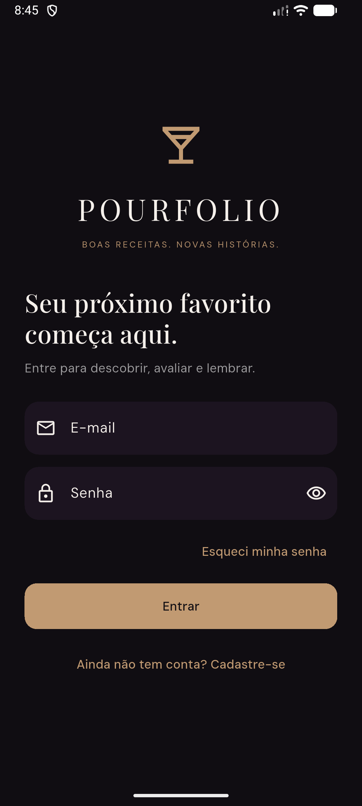
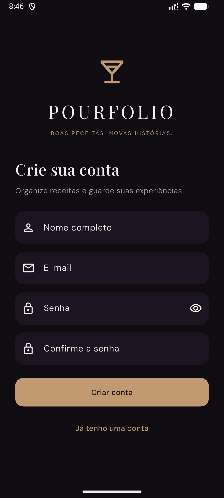
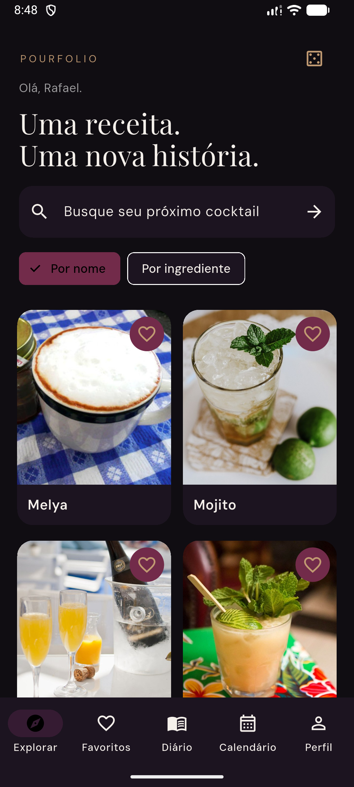
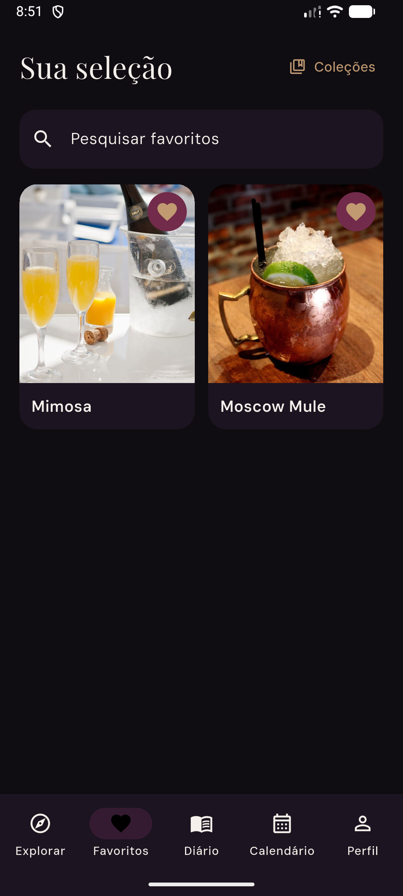
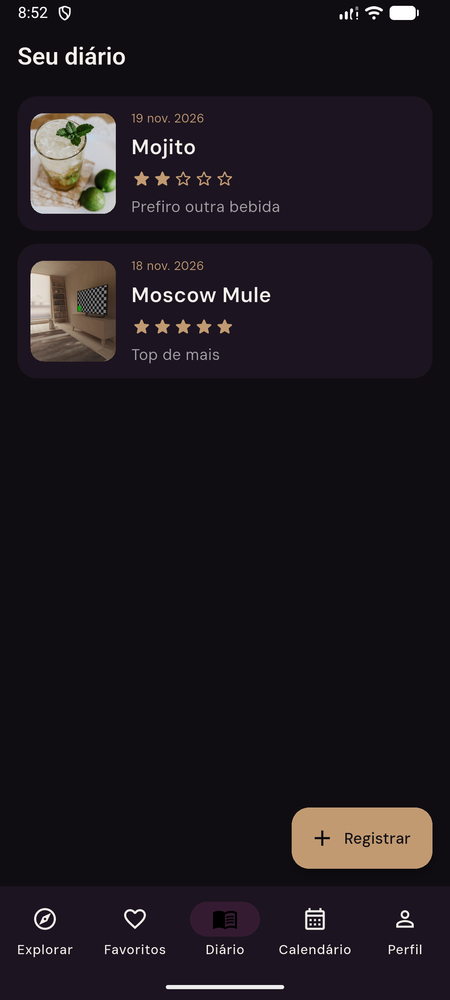
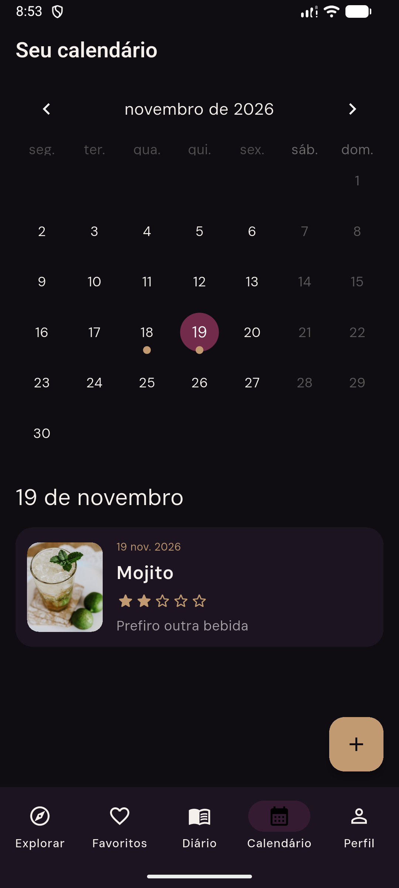
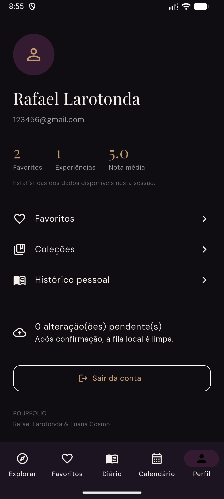

# 🍸 Pourfolio

> Diário de cocktails estilo Letterboxd: descubra receitas, organize favoritos e coleções e registre cada experiência com nota, comentário, foto, data e localização — com funcionamento **offline first**.

Trabalho Final da disciplina **Desenvolvimento de Aplicações Mobile** (Flutter e Dart).

## Integrantes

| Nome | GitHub |
| --- | --- |
| Rafael Larotonda | [@RLarotonda](https://github.com/RLarotonda) |
| Luana Cosmo | [@Luanacosmo](https://github.com/Luanacosmo)|

O projeto é uma evolução do [APK_cocktail](https://github.com/RLarotonda/APK_cocktail) (trabalho anterior da disciplina): a integração com a TheCocktailDB foi mantida e a API do GIPHY foi removida.

## Objetivo

Desenvolver um aplicativo Android completo que una autenticação real, banco de dados na nuvem, banco local, sincronização offline, geolocalização, calendário interativo e consumo de API externa. O tema escolhido é um **diário pessoal de cocktails**: o usuário busca receitas, salva favoritos, cria coleções e registra experiências (nota de 1 a 5, comentário, foto, data e coordenadas GPS).

## Telas

| Login | Cadastro | Explorar |
| :---: | :---: | :---: |
|  |  |  |

| Favoritos | Diário | Calendário | Perfil |
| :---: | :---: | :---: | :---: |
|  |  |  |  |

## Funcionalidades

**Identidade visual**
- Nome próprio, ícone personalizado e splash screen nativa.
- Tema escuro (vinho e champagne) centralizado em `lib/theme/app_theme.dart`; fontes locais Playfair Display e DM Sans.
- Navegação inferior com 5 abas (Explorar, Favoritos, Diário, Calendário, Perfil) e layout adaptável.

**Autenticação (Firebase Authentication)**
- Cadastro com nome completo, e-mail, senha e confirmação de senha.
- Login com validação de campos, mensagens de erro e indicador de carregamento.
- Recuperação de senha por e-mail e logout.
- Cada usuário acessa apenas os próprios registros (regras do Firestore por `uid`).

**Dados na nuvem (Cloud Firestore)**
- CRUD completo em `users/{uid}/diary`, `users/{uid}/favorites` e `users/{uid}/collections`.
- Camada de serviço dedicada (`FirestoreService`) e regras de segurança em `firestore.rules`.

**Dados locais (SQLite / sqflite)**
- Banco local com a fila de operações pendentes (`pending_operations`) e a associação de fotos (`photo_attachments`).
- Cadastro, consulta, edição e exclusão locais; os dados pendentes sobrevivem ao fechar e abrir o app.

**Offline first e sincronização**
- Toda alteração é gravada primeiro no SQLite, dentro de uma transação.
- `connectivity_plus` detecta a volta da conexão e dispara a sincronização automática (também ao retomar o app e a cada 20 s com pendências).
- Identificador único (UUID) por registro: reenviar nunca duplica.
- Exclusões offline são registradas como operação `delete` (tombstone) e replicadas na nuvem depois.
- Após a confirmação do servidor, o registro é removido do armazenamento local.

**Geolocalização (geolocator)**
- Verifica se o GPS está ligado, explica a finalidade, solicita a permissão e mostra latitude e longitude.
- As coordenadas ficam associadas ao registro do diário.

**Calendário (table_calendar)**
- Calendário mensal com navegação, seleção de data e marcadores nos dias com registros.
- Lista os registros do dia selecionado e permite cadastrar uma experiência naquela data.

**Imagens (image_picker)**
- Foto pessoal da galeria associada à experiência, copiada para a pasta privada do app.

**API externa (http)**
- TheCocktailDB: busca por nome, busca por ingrediente, detalhes da receita e drink aleatório, com timeout e tratamento de erros.

**Botões (Material 3)**
- `FilledButton`, `OutlinedButton`, `TextButton`, `IconButton` e `FloatingActionButton`, todos com função real.

## Tecnologias

Flutter · Dart · Material 3 · Firebase Authentication · Cloud Firestore · SQLite · TheCocktailDB API

## Bibliotecas utilizadas

| Pacote | Finalidade |
| --- | --- |
| `firebase_core` | Inicialização do Firebase |
| `firebase_auth` | Autenticação |
| `cloud_firestore` | Banco de dados na nuvem |
| `sqflite` / `sqflite_common` | Banco de dados local |
| `path` / `path_provider` | Caminhos e diretórios do dispositivo |
| `connectivity_plus` | Monitoramento de conectividade |
| `geolocator` | Geolocalização (GPS) |
| `table_calendar` | Calendário interativo |
| `image_picker` | Seleção de imagens |
| `http` | Consumo da API externa |
| `uuid` | Identificadores únicos offline |
| `intl` / `flutter_localizations` | Datas e idioma pt-BR |
| `flutter_launcher_icons` / `flutter_native_splash` | Ícone e splash (dev) |

As versões exatas estão no [`pubspec.yaml`](pubspec.yaml).

## Estrutura do projeto

```
lib/
├── main.dart                 # ponto de entrada; inicializa o Firebase
├── firebase_options.dart     # gerado pelo FlutterFire CLI
├── model/                    # entidades (cocktail, diário, coleção, operação pendente)
├── database/                 # abertura e esquema do SQLite
├── service/                  # auth, Firestore, SQLite, sincronização, API, GPS, imagens
├── controllers/              # LibraryController: estado da área autenticada
├── view/                     # telas
├── components/               # widgets reutilizáveis
└── theme/                    # tema e cores
assets/   (fontes e ícones)       docs/   (documentação)       firestore.rules
```

## Como o offline funciona

```
Tela salva ──► SQLite (pending_operations) ──► SyncService ──► Firestore
                    ▲                                              │
                    └──── remove a linha SOMENTE após a confirmação ┘
```

- **Com internet:** grava no SQLite, envia, o servidor confirma e a linha local é apagada.
- **Sem internet:** o registro fica no SQLite e continua visível, editável e excluível; permanece após fechar e abrir o app.
- **Internet de volta:** as pendências são enviadas na ordem, com o mesmo ID, sem duplicar.

Um campo `revision` impede que a confirmação de uma versão antiga apague uma edição mais recente feita durante o envio.

## Como executar

### Pré-requisitos
- Flutter estável compatível com Dart `>= 3.12.2` (`flutter doctor` sem erros)
- Android SDK e um emulador ou aparelho Android (API 24 ou superior)
- Conta Google (apenas se quiser usar outro projeto Firebase)

### Passo a passo

```bash
git clone https://github.com/RLarotonda/pourfolio.git
cd pourfolio
flutter pub get
dart run flutter_launcher_icons
dart run flutter_native_splash:create
flutter devices
flutter run
```

O repositório já inclui a configuração do projeto Firebase `pourfolio-cocktail` (`lib/firebase_options.dart` e `android/app/google-services.json`), então o app roda sem etapas extras. Para usar **outro** projeto Firebase, siga [docs/CONFIGURACAO_FIREBASE.md](docs/CONFIGURACAO_FIREBASE.md).

### Gerar o APK

```bash
flutter build apk --release
```

Saída: `build/app/outputs/flutter-apk/app-release.apk`. O APK também está disponível na aba **Releases** do repositório.

## Estrutura de dados (Firestore)

```
users/{uid}/diary/{uuid}              # experiências: nota, comentário, data, latitude, longitude
users/{uid}/favorites/{cocktailId}    # receitas favoritas
users/{uid}/collections/{uuid}        # coleções de receitas
```

## Documentação

- [Planejamento](docs/PLANEJAMENTO.md)
- [Configuração do Firebase e do APK](docs/CONFIGURACAO_FIREBASE.md)
- [Checklist de testes e roteiro da apresentação](docs/CHECKLIST_TESTES.md)
- [Guia de defesa do código](docs/GUIA_DEFESA.md)
- [Validação da entrega](docs/VALIDACAO.md)

## Limitações conhecidas

- Apenas Android é alvo desta entrega.
- As fotos pessoais ficam somente no aparelho (não usam Firebase Storage) e não acompanham a conta em outro dispositivo.
- Por exigência do trabalho (limpar o armazenamento local após o envio), ao abrir o app **sem internet** aparecem somente as pendências locais; o histórico já sincronizado exige conexão.
- Entre aparelhos, prevalece a última alteração confirmada pelo servidor (sem mesclagem de conflitos).
- A assinatura do APK de release usa a chave de debug (suficiente para instalação acadêmica).

## Créditos

- Receitas e imagens: [TheCocktailDB](https://www.thecocktaildb.com/api.php) (chave de teste `1`, uso educacional).
- Fontes: Playfair Display e DM Sans, sob licença OFL (arquivos em `assets/fonts/`).
- Projeto acadêmico, sem fins comerciais.# Pourfolio
# Pourfolio
# Pourfolio_app
# Pourfolio
